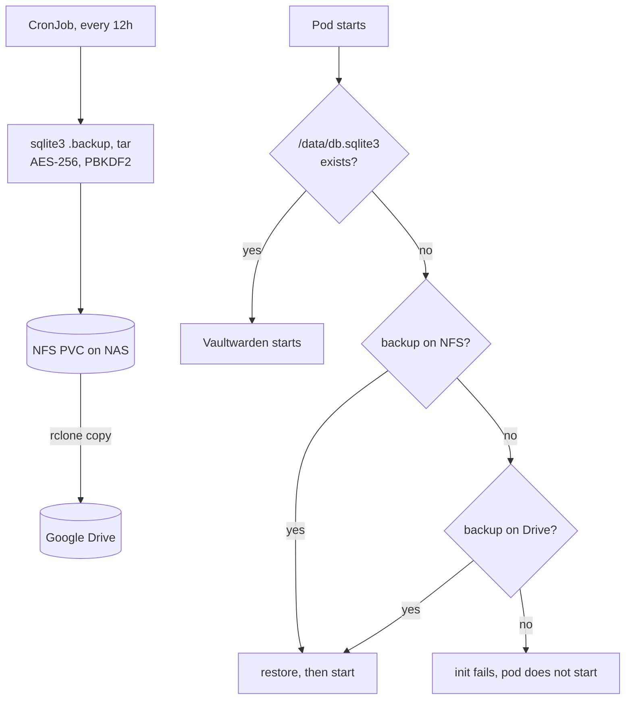

# Storage and backups

Nodes hold nothing worth keeping. Every byte that matters is on the Synology DS923+ or in
this repository, which is what makes a node a disposable PXE boot instead of a machine
anyone has to be careful with.

## Storage classes

The [Synology CSI driver](../kubernetes/kustomizations/synology-csi/) provisions both iSCSI
LUNs and NFS shares from the NAS. Ten storage classes exist, and their names follow a
pattern instead of being a list to memorise:

```text
synology-<protocol>-<reclaim>[-<tier>][-<purpose>]
```

| Axis | Values | Chosen by |
| --- | --- | --- |
| protocol | `iscsi`, `nfs` | Block for single-writer databases and config, NFS for anything `ReadWriteMany` |
| reclaim | `retain`, `delete` | Whether losing the PVC should be survivable |
| tier | *(none)* = HDD, `ssd` = `/volume2` | Latency vs. capacity |

`synology-nfs-delete` is the cluster default. The safe thing to get by accident is a volume
that goes away with its claim, not one that quietly accumulates on the NAS forever.

Three of the parameters took some working out:

- **iSCSI volumes are btrfs, formatted `--nodiscard`.** Discard during format on a
  thin-provisioned LUN issues a very large number of UNMAPs to the NAS for no benefit,
  because the LUN is empty by definition.
- **PostgreSQL gets a class of its own**, `synology-nfs-retain-ssd-postgres`, mounted `hard`
  with `0750` permissions. A soft NFS mount returns I/O errors on interruption, and a
  database that receives an I/O error where it expected a pause can corrupt its data files.
  Everywhere else the mount options are a preference. Here they are a correctness
  requirement.
- **`synology-nfs-delete-fsgroup` is the NFS class that agrees with `fsGroup`.** See
  [below](#who-may-write-to-a-volume).

All classes allow volume expansion, so growing a volume is an edit to a PVC.

## Who may write to a volume

A pod that is not root can write to its volume when the pod declares an `fsGroup`. The
[`CSIDriver`](../kubernetes/kustomizations/synology-csi/csi-driver.yml) sets
`fsGroupPolicy: File`, so the kubelet gives a volume to that group as it mounts it, NFS
included. Left at its default the kubelet does so only for a volume with an `fsType`, which
no NFS volume has, and the driver for its part sets the mode of an NFS volume's root and
never its owner. A pod could then write only to a share it happened to own, or needed a root
init container to `chown` it, which a namespace enforcing `restricted` does not allow.

The driver's `mountPermissions` works against this unless the class is chosen for it. The
mode is applied on every mount, so `0755` takes group write off the root each time. The
kubelet reads that as a volume not yet prepared and goes over every file again, whatever
`fsGroupChangePolicy: OnRootMismatch` asks, adding group access as it goes. Two things
follow:

- **A new NFS volume for a pod with an `fsGroup` belongs in `synology-nfs-delete-fsgroup`.**
  It mounts `0770`, which is the mode the kubelet leaves, so the two agree and a volume is
  gone over once, while it is empty. A file written `0600` afterwards stays `0600`.
- **On the older NFS classes a pod with an `fsGroup` has its whole volume gone over at every
  start.** The mode is fixed into a volume when it is provisioned, so the volumes those
  classes already made keep it. That costs nothing noticeable on a small volume. nzbget
  mounts the 7 TiB downloads claim and declares no `fsGroup` for this reason.

## Snapshots

The [external-snapshotter](https://github.com/kubernetes-csi/external-snapshotter) CRDs are
pulled straight into the kustomization from a pinned upstream tag, and a default
`VolumeSnapshotClass` points at the Synology driver. That makes CSI snapshots available to
anything that asks for one, Velero above all.

## Velero

[Velero](../kubernetes/helm/velero/values.yaml) runs two schedules with different jobs.

| Schedule | Cadence | Retention | Scope |
| --- | --- | --- | --- |
| `cluster-full` | daily | 30 days | Every Kubernetes object |
| `csi-opt-in-pvc-snapshots` | every 12 hours | 7 days | Only PVCs labelled `backup.velero.io/csi-snapshot: "true"` |

They are split because the two things cost wildly different amounts. Every Kubernetes object
in the cluster fits in a few megabytes, so there is no reason to be selective. Volume
snapshots are the opposite, and a 7 TiB media library has no business in a backup rotation
when it can be downloaded again and its contents already sit on the NAS.

Volume backup is therefore **opt-in by label**, and each PVC that carries the label carries
it for a reason:

```yaml
labels:
  backup.velero.io/csi-snapshot: "true"
```

Backups land in a [Garage](https://garagehq.deuxfleurs.fr/) S3 bucket on the NAS. The
location is deliberately **not** marked default. A backup should be sent somewhere on
purpose, not by omission.

Object-level backups matter less here than they would elsewhere, because the manifests are
all in git. Velero's real value in this cluster is the volume data and the objects nobody
declared: generated secrets, CRD state, whatever ArgoCD would recreate but not repopulate.

## Application-level backup: Vaultwarden

A password manager gets a third layer. The recovery story for everything else, rebuilding
the cluster from git, is far too slow for the thing that holds every credential. The
[backup and restore images](../apps/vaultwarden/) built in this repository do it:



What makes it hold up:

- **`sqlite3 .backup` instead of copying the file.** A live database copied byte-for-byte can
  be mid-transaction; the backup API produces a consistent snapshot without stopping
  Vaultwarden.
- **The job is pinned to Vaultwarden's node by `podAffinity`.** The database runs in WAL
  mode, and WAL readers coordinate with the writer through the `-shm` mmap, which is only
  coherent between processes on one host. The data claim is an iSCSI LUN, so nothing at the
  storage layer prevents a second node attaching it - it was `ReadWriteMany` until it became
  clear that meant two kernels caching the same non-cluster filesystem. Scheduled away from
  Vaultwarden, the backup reads a `-wal` that never looks settled and `.backup` restarts its
  copy indefinitely: one run burned a full core for 16 hours on a 1.3 MB database. Co-located
  it finishes in about twenty seconds. `ReadWriteOnce` now states the same constraint to the
  scheduler, and still permits both pods on the node they share.
- **A hang is bounded in two places.** `concurrencyPolicy: Forbid` is what makes an
  unbounded job dangerous rather than merely slow: it never returns, so every later run is
  skipped and the schedule dies quietly - the failure above went unnoticed for a day, and
  was visible only as a CPU graph. `activeDeadlineSeconds` kills the job, and a `timeout`
  around `.backup` itself fails the step first so the log says which stage hung, rather than
  leaving a deadline to explain it.
- **The signing key travels with the data.** `rsa_key.pem` is not part of the vault's
  encryption and decrypts nothing, so archiving it alongside the database costs nothing that
  the AES-256 wrapper does not already cover. Leave it out and Vaultwarden mints a fresh one
  on restore, at which point every session and every remembered 2FA device stops verifying.
  That was learned by restoring without it and meeting `Error decoding JWT: InvalidSignature`
  at the next login. Archives written before the key was included still restore; they warn
  that sessions are about to be invalidated rather than failing over it.
- **The restore runs as an init container.** Nobody has to notice that a volume came up
  empty and go looking for a runbook. It is repaired before Vaultwarden opens it.
- **Failing to restore fails the pod.** Starting empty would present a working but empty
  vault, and the first client to sync would overwrite its own copy with nothing. Refusing to
  start is the safer failure, and it was chosen on purpose. The restore checks that the
  database file exists after extraction rather than trusting a decrypt-and-untar pipeline's
  exit code.
- **The remote copy is off-site and encrypted before it leaves the cluster**, with a key
  Google Drive never sees. The key reaches `openssl` as `-pass env:`, never as a process
  argument, so it cannot leak through `ps` or `/proc`.
- **A failed remote upload is a warning, not a failure.** The local copy on the NAS already
  exists, so failing the whole job over that would mean a red CronJob for a condition that
  lost nothing. Every other step is fatal, and `backoffLimit: 0` keeps a genuine failure
  visible instead of letting it retry into a loop.

Both images run as UID 1000, non-root, read-only root filesystem, all capabilities dropped,
and they are built from [Docker Hardened Images](supply-chain.md#base-images) and signed
like everything else published here.

## Protecting data from GitOps itself

Automated `prune` is what makes GitOps trustworthy, and also what makes it dangerous near
storage. Deleting a manifest deletes the object, and for a PVC that can mean deleting the
volume.

Data claims opt out explicitly:

```yaml
annotations:
  argocd.argoproj.io/sync-options: Delete=false,Prune=false
```

The media namespace, its 7 TiB downloads claim and both Vaultwarden PVCs carry it. Combined
with `reclaimPolicy: Retain` on the storage class, removing an application from git tears
down its workloads and leaves its data on the NAS.

## What is actually recoverable

Coverage is uneven, so it is worth setting out case by case:

| Loss | Recovery | Time to restore |
| --- | --- | --- |
| A node | PXE boot a replacement, it rejoins | Minutes, no data involved |
| The whole cluster | [Bootstrap from this repository](operations.md#bootstrapping-from-nothing) | Everything declarative returns unattended |
| A PVC | Velero CSI snapshot, if it was labelled | Up to 12 hours of data |
| Vaultwarden data | Local backup, then Google Drive, automatically | Up to 12 hours, and the only path that survives losing the NAS |
| The NAS | Vaultwarden restores from Drive. Everything else was on it. | Media is re-acquirable, other volumes are not |

That last row is the standing gap, and a known one. Velero's bucket lives on the same NAS as
the volumes it backs up, so it protects against deletion and corruption but not against
hardware loss. Fixing it means paying for an off-site S3 target, which is the only thing
stopping it.

The other unrecoverable case is losing every way to unlock the repository. The git-crypt key
is committed here as the Secret ArgoCD mounts, encrypted with itself, so it is no use for
bootstrapping. That needs either the exported key file kept elsewhere or the GPG key
registered under [`.git-crypt/keys/`](../.git-crypt/). Two independent paths, both held
outside this repository. Lose both and nothing here decrypts, backups included. See
[GitOps](gitops.md#secrets-in-a-public-repository).

## See also

- [Synology notes](synology.md): what is configured on the NAS itself, by hand
- [Architecture](architecture.md#where-the-state-lives): how storage fits the whole
- [Operations](operations.md): restore procedures and bootstrap
